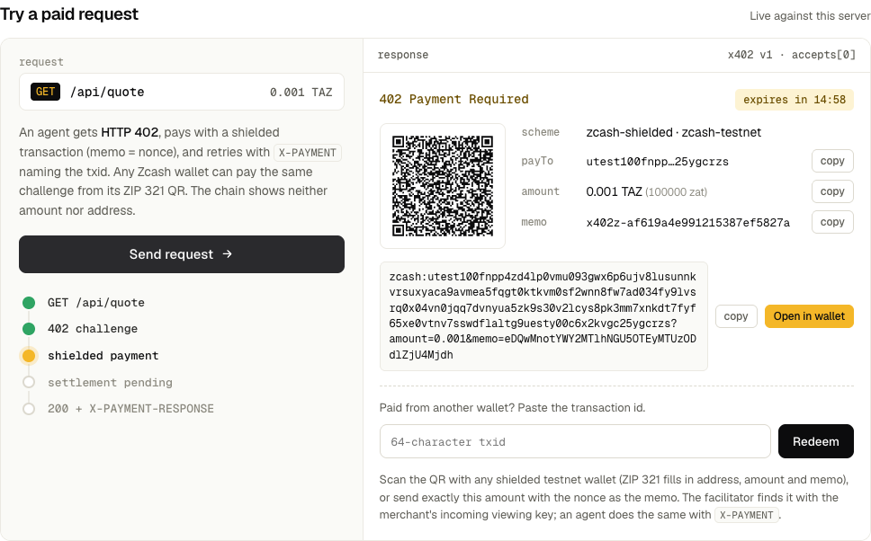

# Kage — shielded x402: private machine payments for AI agents

[](https://github.com/nickthelegend/zec-shielded-x402/actions/workflows/ci.yml) · **Landing:** [nickthelegend.github.io/zec-shielded-x402](https://nickthelegend.github.io/zec-shielded-x402/) (also at [kage-landing.vercel.app](https://kage-landing.vercel.app)); **spec and recorded evidence:** [evidence.html](https://nickthelegend.github.io/zec-shielded-x402/evidence.html) (static pages with recorded output; run the stack yourself with four commands, [below](#run-the-whole-stack-locally-four-commands)) · **Live 402 on testnet:** [https://kage-api.201-18-198-162.sslip.io/api/quote](https://kage-api.201-18-198-162.sslip.io/api/quote) (facilitator: [https://kage-facilitator.201-18-198-162.sslip.io/health](https://kage-facilitator.201-18-198-162.sslip.io/health)) · [Testing](TESTING.md)

HTTP 402 payments for AI agents, settled as **Zcash shielded** testnet transactions, in the **x402 v1 wire format**.
- **Merchant side.** The facilitator verifies a payment with the merchant's **incoming viewing key** alone. It holds no spend key, and it can't see the merchant's own spends or change.
- **Agent side.** Before the agent builds any transaction, **spendguard** checks it against a daily cap, a host allowlist and an approval threshold.
- **Any wallet can pay.** Each 402 carries a ZIP 321 URI and a QR code.
- **LLM agents** call the same flow through an MCP server. On 2026-10-22 an LLM (opencode, a free OpenRouter model) paid two 402s from the agent's own wallet this way ([transcript](docs/mcp-paid-run.txt)).



**Verify in a few minutes.**
1. Open [`f037d597…e22a`](https://testnet.zecblock.com/tx/f037d5978fec7817340ff118d328995288f0a575a1850b083ca05f7d71d4e22a) on the testnet explorer: a shielded transaction with no visible amount or address. An LLM paid it over MCP from the agent's own wallet.
2. Read what the LLM did: the [rendered transcript](docs/mcp-paid-run.txt) and the [unedited events](docs/mcp-paid-run.jsonl) (`paid_fetch` → `settlement_pending` → `redeem_payment` → `200`, `payer: ""`).
3. Decrypt it with the merchant's published incoming viewing key only: `check_uivk "$uivk" f037d5978fec7817340ff118d328995288f0a575a1850b083ca05f7d71d4e22a x402z-ca140754c5e37e36f106ed84` prints `incoming 100000 zat via Ironwood, memo text "x402z-ca140754c5e37e36f106ed84"` (command and key under [Verified testnet runs](#verified-testnet-runs)). This one is slow the first time: building `check_uivk` compiles librustzcash, several minutes.
4. `cargo test -p x402z-server`: 42 tests, about 2 minutes on a first build, no Zcash crates.

```
agent -> GET /api/quote
      <- 402 {x402Version: 1, accepts: [{scheme: "zcash-shielded", network: "zcash-testnet",
              maxAmountRequired, payTo, asset: "ZEC", extra: {memoNonce, expiresAt, paymentUri}}]}
      -> spendguard.check() -> shielded tx from the agent's own wallet (memo = nonce)
      -> GET /api/quote  X-PAYMENT: base64 {x402Version, scheme, network, payload: {txid, memoNonce}}
         server -> facilitator POST /settle -> lightwalletd -> trial-decrypt with the merchant UIVK
                -> ed25519 receipt (minedAt) -> server checks signature, burns the nonce (SQLite)
      <- 200 + X-PAYMENT-RESPONSE: base64 {success, transaction, network, payer: ""}
```

## Status (honest)

| Part | State |
|---|---|
| `crates/spendguard`: cap, allowlist (an entry may pin a port and a scheme), approval threshold; `sealed`, the at-rest format of the agent's ledger and tab file (XChaCha20-Poly1305) | **Done.** 16 unit tests |
| `crates/x402z-protocol`: x402 v1 types (`PaymentRequiredResponse`, `PaymentRequirements`, `X-PAYMENT`, `X-PAYMENT-RESPONSE`, `/settle`, `/supported`), challenge validation, ZIP 321 URIs | **Done.** 14 tests, including the x402 spec's own 402 and payload examples, and ZIP 321's memo example |
| `crates/x402z-server`: paywalled `/api/quote`, `X-PAYMENT` settlement via the facilitator, `POST /api/redeem` (paste a txid), QR, per-client rate limit on challenges and payment attempts, Kage Tab (blind-RSA tokens, key grace period); the same `X-PAYMENT` answered again for 10 minutes so a lost 200 is not a refusal; dashboard, feed and status on a separate loopback admin port that checks `Host` (DNS rebinding); an index on open challenges, pruned once a minute | **Done.** 42 tests, including 6 Kage Tab attack tests |
| `crates/x402z-facilitator`: lightwalletd gRPC, UIVK trial decryption (Sapling, Orchard, Ironwood), mined-block-time expiry, SQLite bindings keyed by (nonce, payTo, amount), `/verify` `/settle` behind a bearer token, `/supported`, `/health` cached for 5 s | **Done.** 17 tests. 6 of them build transactions in-process with real keys, real note encryption and real Halo2 proofs for the Orchard/Ironwood parts (Sapling outputs use sapling-crypto's mock proof bytes); these are **not broadcast**. 3 verify the ten real Kage payments live against testnet.zec.rocks with only the published UIVK |
| `crates/x402z-agent`: 402 → spendguard → `zcash_client_sqlite` wallet → pay → `X-PAYMENT`, no redirects followed, allowlist and an https rule checked before the first request, bodies capped at 1 MiB, ledger sealed at rest and file-locked, an unknown broadcast outcome charged to the cap; a broadcast but unsettled payment is resumed instead of paid twice, also when two calls for the same URL or tab race (re-checked under the ledger lock) or the process stops mid-broadcast (the txid is in the ledger before the broadcast); a settled payment the server calls already redeemed stays settled (exit 6, "do not pay again"); Kage Tab client (`tab-buy`, `tab-redeem`, `tab-fetch`, `tab-status`) that pins the merchant's key per epoch | **Done.** 32 tests. Paid live from its own wallet: on Oct 20 by the CLI agent (pre-x402-v1 code), and on Oct 22 twice, each payment chosen by an LLM over MCP |
| `crates/x402z-mcp`: MCP server over stdio, with tools `paid_fetch`, `redeem_payment`, `tab_fetch`, `spend_status`, `ledger_tail`; returns right after a broadcast instead of holding the call for a block | **Done.** 7 stdio tests. Live LLM runs via opencode: a spendguard refusal (Oct 21, [transcript](docs/mcp-live-run.txt)) and two payments from the agent's own wallet (Oct 22, [transcript](docs/mcp-paid-run.txt)) |
| `packages/x402-zcash`: TypeScript client (parse the 402, ZIP 321, `X-PAYMENT`) and an Express/Node paywall middleware that settles through the facilitator, with a per-client rate limit, a facilitator timeout, the resend window, and an in-memory challenge store that is pruned and capped (single process, not durable: pass your own store for production) | **Done.** 11 tests: 9 without a chain, 2 against the real binaries and testnet (the middleware settles real tx `ccb4214c` for its own nonce) |
| Agent ledger and Kage Tab tokens encrypted at rest (XChaCha20-Poly1305 under `X402Z_AGENT_LEDGER_KEY` or a key derived from the agent seed) | **Done.** A wrong key or a changed byte is refused, never read as empty |
| Paid end-to-end runs on testnet | **Done.** Ten txids; eight on x402 v1 code (three are Kage Tabs), two paid from the agent's own wallet by an LLM; see [Verified testnet runs](#verified-testnet-runs) |

Nothing is mocked. If a binary is missing a key, a wallet or funds, it stops with an error and a non-zero exit code. It never fakes a payment. Test counts and what each test does and doesn't prove are in [TESTING.md](TESTING.md).

## What still leaks

Shielding hides the amount, the memo and both parties from the chain. It doesn't hide everything:
- **The merchant sees the client's IP.** The paid request is ordinary HTTP. Use Tor or a proxy if that matters.
- **lightwalletd sees which txid is looked up**, and when. The payer's wallet broadcasts through it, and the facilitator fetches the tx by id, so the operator can link the two lookups to the merchant's facilitator.
- **`X-PAYMENT` is a bearer credential.** Whoever presents a paid (memoNonce, txid) first gets the content and burns the nonce, and for 10 minutes after that (`X402Z_RESEND_WINDOW_SECS`) the same pair gets the content again, so a payer whose 200 was lost is not refused. Keep the pair private. Until Oct 22 the server's own feed (`/api/events`) was public on the API port and listed pending pairs and client IPs; it now lives on a loopback admin port, shows only a nonce prefix next to a txid, and never an IP.
- **Kage Tab unlinkability assumes one key per epoch for everyone.** A dishonest merchant could hand each buyer a key of its own and link every token. The agent pins the key it saw for a server for that key's epoch and refuses a different one, so a merchant can't switch keys on it; it can't tell whether other buyers got the same key.
- **On the payer's disk**, the agent ledger (hosts, amounts, nonces, txids) and unspent Kage Tab tokens are sealed with XChaCha20-Poly1305. Anyone holding `X402Z_AGENT_LEDGER_KEY` or the agent seed can read them.
- **Timing.** A payment lands in the block after the 402 was issued, so someone watching both the HTTP traffic and the chain can correlate the two by time, even though the transaction itself reveals nothing.

## Prior art, and what Kage adds

- **coinbase/x402 v1** defines the 402 body, `X-PAYMENT`, `X-PAYMENT-RESPONSE` and the facilitator's `/verify`, `/settle` and `/supported`, with EVM `exact` payments. Kage keeps that wire format and adds a `zcash-shielded` scheme.
- **"Shielded x402"**, a Zcash Community Grants application posted on 2026-09-25 by the forum user **baby-zack-agent** (Zcash forum topic 57826), proposed private machine payments over x402 and was rejected on 2026-09-28. That application is another applicant's, not Kage's author's. Kage's subtitle echoes its title, but Kage is a separate build by Nivesh Gajengi and shares none of that application's code.

What Kage adds:
- **A UIVK-only facilitator.** It verifies payments with the merchant's incoming viewing key alone; a test shows that key sees neither the merchant's change nor its outgoing payments.
- **spendguard before the wallet.** Cap, allowlist and approval threshold are checked before any transaction exists, under a file lock, with redirects refused and unknown broadcasts charged.
- **Kage Tab.** One shielded payment buys N RFC 9474 blind-RSA tokens the server can't link to the payment.
- **x402 v1 wire compliance**, tested against the spec's own examples, with a TypeScript client and middleware.
- **Live, checkable transactions.** Ten testnet payments, each verifiable by anyone with the published demo UIVK.

## Do X → see Y

1. Run the fast tests one crate at a time (low-RAM friendly):
   ```sh
   cargo test -p spendguard -p x402z-protocol -p x402z-server   # 16 + 14 + 42
   cargo test -p x402z-agent                                      # 32 (Tab client and key rules against a localhost issuer, redirects, races, allowlist before any request)
   cargo test -p x402z-mcp                                        # 7 (drives the binary over stdio)
   cargo test -p x402z-facilitator                                # 17: 6 prove Halo2 bundles (~40 s), 3 hit testnet live
   cd packages/x402-zcash && npm test                             # 11: TypeScript, 2 against the real binaries and testnet
   ```
   That makes 128 Rust tests and 11 TypeScript tests, 139 in all; 5 of them reach live testnet (the facilitator's 3 and the TypeScript package's 2, which need network). The browser E2E suite is separate: see [Run the whole stack locally](#run-the-whole-stack-locally-four-commands).
2. Run `cargo run -p x402z-facilitator` with no `.env`. It prints `error: X402Z_MERCHANT_UIVK not configured` and exits with code 2. With the key but no `X402Z_FACILITATOR_TOKEN`, it prints `error: Setup required: X402Z_FACILITATOR_TOKEN not configured …` and exits 2.
   - If `ZCASH_LWD_URL` is unset, it says so and uses `https://testnet.zec.rocks:443`.
   - If lightwalletd is unreachable, it prints `error: cannot connect to lightwalletd: …` and exits with code 1.
3. Run `cargo run -p x402z-facilitator -- keygen`. It prints a fresh `X402Z_RECEIPT_SIGNING_KEY` / `X402Z_RECEIPT_PUBKEY` pair.
4. Run `X402Z_AGENT_WALLET_DIR=./wallets/merchant cargo run -p x402z-agent -- new-wallet`. It creates a real testnet wallet and prints its seed phrase, birthday height, shielded address and incoming viewing key (`X402Z_MERCHANT_UIVK`). Use one such wallet for the merchant (UA + UIVK) and another for the agent.
5. Run the agent. Each exit code means one thing:

   | Situation | Output | Exit |
   |---|---|---|
   | Cap below the price, or host not in `X402Z_AGENT_ALLOWED_HOSTS` | `spendguard refused the payment: … No transaction was built or broadcast.` | 3 |
   | No `X402Z_AGENT_SEED` | `X402Z_AGENT_SEED not configured: no funded testnet wallet to pay from …` | 4 |
   | Wallet synced but holding too little TAZ | `insufficient testnet balance: spendable 0 zat …, need at least 110000 zat … Send TAZ to utest1…` | 4 |
   | Server/facilitator refuses the payment | `server refused payment tx … (402 Payment Required, invalid_payment): …` | 5 |
   | The server says the payment's nonce was already redeemed (it settled earlier and the 200 was lost, after the server's 10-minute resend window) | `tx … was already redeemed … Do NOT pay again for it.` The ledger keeps it settled | 6 |
   | Paid | the paid JSON on stdout, `X-PAYMENT-RESPONSE: success=true …` on stderr | 0 |

   Every decision is appended to `X402Z_AGENT_LEDGER`, sealed at rest (the dashboard shows it only in a one-machine demo, see below). Two agent runs at once take turns on `<ledger>.lock`, so they can't both pass the cap. Without `X402Z_AGENT_LEDGER_KEY` or a seed to derive it from, the agent stops with `Setup required: X402Z_AGENT_LEDGER_KEY not configured …` (exit 2).
6. Send more than `X402Z_CHALLENGE_RATE_PER_MIN` requests (default 30) to `/api/quote` from one client: 402 challenges and `X-PAYMENT` attempts count alike. You get `429 Too Many Requests` with a `Retry-After` header. Only a directly presented facilitator receipt (`X-PAYMENT-RECEIPT`) skips the budget. An `X-PAYMENT` whose nonce or txid can't be real is a `400` before anything is looked up.

## x402 wire format

Kage follows coinbase/x402 [`specs/x402-specification-v1.md`](https://github.com/coinbase/x402/blob/main/specs/x402-specification-v1.md) and [`specs/transports-v1/http.md`](https://github.com/coinbase/x402/blob/main/specs/transports-v1/http.md) (read 2026-10-21). A v2 spec also exists, with CAIP-2 networks and `PAYMENT-SIGNATURE` / `PAYMENT-REQUIRED` headers. Kage implements v1.

- **402 body.** `{x402Version: 1, accepts: [PaymentRequirements], error}`. The Zcash entry is: `scheme: "zcash-shielded"`, `network: "zcash-testnet"`, `maxAmountRequired` (zatoshi, as a string), `resource`, `description`, `mimeType`, `payTo` (a shielded-only UA), `maxTimeoutSeconds: 900`, `asset: "ZEC"`, and `extra: {memoNonce, expiresAt, paymentUri}`.
- **`X-PAYMENT`.** Base64 JSON `{x402Version: 1, scheme, network, payload: {txid, memoNonce}}`. The payload adds `memoNonce` to the txid for a reason: a shielded transaction gives the server nothing to look up, so the payer names the challenge it paid. The facilitator then finds that same nonce inside the encrypted memo, so a payment can't be pointed at a different challenge.
- **`X-PAYMENT-RESPONSE`.** Base64 JSON `{success, errorReason?, transaction, network, payer}`. `payer` is always `""`: nobody, the merchant included, learns the payer's address. A payment that isn't confirmed yet gets `402` with the *same* challenge and `errorReason: "settlement_pending"`, so the client retries the same `X-PAYMENT`. Other reasons are `invalid_payment`, `payment_expired`, `nonce_already_used`, `unknown_challenge`, `invalid_payload`, `invalid_network`, `invalid_scheme` and `facilitator_error` (that last one comes with a 502, and nothing is burned).
- **Facilitator endpoints.** `GET /supported` returns `{kinds: [{x402Version: 1, scheme: "zcash-shielded", network: "zcash-testnet"}]}`. `POST /verify` and `POST /settle` take `{x402Version, paymentPayload, paymentRequirements}` and require `Authorization: Bearer $X402Z_FACILITATOR_TOKEN` (401 otherwise); the resource server holds the same token. `/verify` is read-only and returns `{isValid, invalidReason, payer}`. `/settle` binds the requirement (nonce, payTo, amount) to the txid and returns the settlement fields plus Kage's ed25519 `receipt` and `claims`. The resource server trusts only receipts signed by `X402Z_RECEIPT_PUBKEY`.
- **TypeScript.** [`packages/x402-zcash`](packages/x402-zcash) parses the 402, renders the ZIP 321 URI, sends `X-PAYMENT`, and has an Express/Node `paywall()` middleware that settles through the same facilitator. It has no runtime dependencies. The x402 v2 header names are not implemented.
- **Back-compat.** `X-PAYMENT-RECEIPT` (a receipt presented directly) and the legacy `/verify {challenge, txid}` body still work.

## Any wallet can pay (ZIP 321)

`extra.paymentUri` is a [ZIP 321](https://zips.z.cash/zip-0321) URI: `zcash:<ua>?amount=0.001&memo=<base64url(nonce), no padding>`. librustzcash's own ZIP 321 parser reads it back to the same address, amount and memo (test `zip321_uri`).

The dashboard's 402 card shows:
- the QR code, rendered by the server at `/api/challenge/{nonce}/qr.svg`, with no external service involved;
- the URI, with **copy** and **Open in wallet** buttons;
- a **paste txid** box.

The paste box calls `POST /api/redeem {memoNonce, txid}`. That runs the same checks as `X-PAYMENT` and answers `200 paid` (with the content), `202 pending` (the page re-checks every 15 s), `422 rejected` or `502`. This path was run live on 2026-10-21 with zingo-cli as the third-party wallet (tx `ccb4214c…0ed3`, below).

## Durable state and expiry (no money lost on a slow block)

- **Server.** Issued challenges and redeemed nonces live in SQLite (`X402Z_SERVER_DB`, default `x402z-server.sqlite`). A restart between the 402 and the redeem keeps the challenge redeemable, and a redeemed nonce stays burned. Unredeemed challenges are kept for `X402Z_REDEEM_WINDOW_SECS` (default 24 h) after expiry.
- **Facilitator.** Nonce → txid bindings live in SQLite (`X402Z_FACILITATOR_DB`). After a restart, a nonce still can't be receipted for a second transaction.
- **Expiry is judged by the mined block's header time, not by when the payer asks.** The facilitator reads the block time with `GetBlock` and puts it in the receipt as `minedAt`. The server accepts a receipt when `minedAt <= expiresAt + X402Z_EXPIRY_GRACE_SECS` (default 1200 s, about 16 blocks), even if the receipt is redeemed later. Block header times can be off by a little (consensus allows some miner clock drift), and the grace absorbs that. A mempool-only receipt has no `minedAt`, so it must be redeemed in time.

## MCP server (LLM agents)

`x402z-mcp` speaks MCP over stdio as newline-delimited JSON-RPC 2.0, protocol `2025-06-18` (it also accepts `2025-03-26` and `2024-11-05`). It uses the agent's configuration (`X402Z_AGENT_*`).

| Tool | Does |
|---|---|
| `paid_fetch {url}` | Runs the agent's x402 flow. It returns right after the broadcast with `status: "settlement_pending"`, the txid and the memo nonce, because a payment needs a block (about 75 s) and MCP clients time a call out at about 60 s. Calling it again for the same URL presents that payment again and never pays twice. Spendguard refusals (`spendguard_refused`), wallet problems (`wallet`), rejected payments (`payment_rejected`), a payment the server already redeemed (`already_redeemed`: it settled earlier, do not pay again) and missing config (`setup_required`) come back as `isError: true` tool results with the reason. Payments at or above the approval threshold are always declined, because there's no operator to approve them over MCP |
| `redeem_payment {url, txid, memoNonce}` | Presents an earlier payment with `X-PAYMENT`, once. Returns the paid response with `X-PAYMENT-RESPONSE`, or `settlement_pending`. Never pays |
| `spend_status {}` | Spent today vs the daily cap, remaining budget, allowlist and threshold |
| `tab_fetch {url, buy?}` | Spends one [Kage Tab](#kage-tab-one-payment-n-unlinkable-requests) token on a GET. With no token left for that server, it first buys a tab of `buy` tokens (default `X402Z_AGENT_TAB_SIZE`, 5) from the agent's wallet, inside spendguard, and answers `tab_pending` while that payment confirms; the next call collects the tokens without paying again. Returns the response, `elapsedMs` and `remainingTokens` |
| `ledger_tail {n}` | The last n spendguard decisions |

Requests are served concurrently, so a slow call (wallet sync, proving) doesn't hold up another.

Example client config (opencode `opencode.json`; other MCP clients take the same command). Keep the seed out of the config: point `command` at a small wrapper that loads the agent's environment from a 0600 file and execs `x402z-mcp`.
```json
{ "mcp": { "kage": { "type": "local", "command": ["/path/to/kage-mcp.sh"] } } }
```
```sh
#!/bin/sh
# kage-mcp.sh: X402Z_AGENT_SEED, X402Z_AGENT_BIRTHDAY, X402Z_AGENT_LEDGER, X402Z_AGENT_WALLET_DIR,
# X402Z_AGENT_ALLOWED_HOSTS, X402Z_AGENT_DAILY_CAP_ZAT ... live in agent.env (chmod 600)
set -a; . /path/to/agent.env; set +a
exec /path/to/target/release/x402z-mcp
```

**LLM-paid run (2026-10-22, testnet).** opencode with `openrouter/nvidia/nemotron-3-ultra-550b-a55b:free`; the agent paid from its own fresh wallet (made with `x402z-agent new-wallet`, funded with 450,000 zat by a separate zingo-cli demo wallet). The model chose every call. Raw events in [docs/mcp-paid-run.jsonl](docs/mcp-paid-run.jsonl), rendered unedited in [docs/mcp-paid-run.txt](docs/mcp-paid-run.txt).
- `spend_status`, then `paid_fetch` on `http://127.0.0.1:4220/api/quote`: spendguard allowed 100,000 zat, the wallet broadcast [`f037d597…e22a`](https://testnet.zecblock.com/tx/f037d5978fec7817340ff118d328995288f0a575a1850b083ca05f7d71d4e22a) (block 4529425), and the tool returned `settlement_pending` at once.
- `redeem_payment` with that txid and nonce: `200` and `X-PAYMENT-RESPONSE {"success":true,"payer":""}`.
- `tab_fetch {buy: 3}`: spendguard allowed 300,000 zat, the wallet broadcast [`b75b2415…4b91`](https://testnet.zecblock.com/tx/b75b2415347a7ce317a9b8b5799d07a2ad9ebc44eea92090f0db9d9b590e4b91) (block 4529427), `tab_pending`. The model called `tab_fetch` four more times without waiting; each one collected the same paid tab instead of paying again. The fifth got the 3 tokens and spent one, and two more calls spent the rest in 1 ms and 0 ms.
- `ledger_tail` shows exactly the two payments, the first marked `settled`.

**Refusal run (2026-10-21).** opencode with `openrouter/minimax/minimax-m3.1-flash:free` (retired since), cap 50,000 zat against the server's 100,000 zat 402: `paid_fetch` came back as a tool error, `spendguard refused the payment: daily cap exceeded … No transaction was built or broadcast.`, and `ledger_tail` showed the `denied` entry ([transcript](docs/mcp-live-run.txt)). The Oct 21 MCP `tab_fetch` run in [docs/tab-live-run.txt](docs/tab-live-run.txt) was driven by a Python stdio script, not an LLM.

## Kage Tab: one payment, N unlinkable requests

Every shielded payment is an on-chain transaction, so each one waits for a block and pays a fee. Kage Tab lets one payment buy N tokens that are each spent on one later request. The server cannot link a token back to the payment, or to the other tokens it bought. It uses RFC 9474 blind RSA: RSABSSA-SHA384-PSS-Randomized from the `blind-rsa-signatures` crate, with an RSA-2048 key.

1. **Offer.** The 402's `extra.tab` carries `{scheme: "zcash-shielded-tab", suite, keyId, publicKey (SPKI, base64), unitPriceZat, maxTokens, issuePath: "/tab/issue", epochEndsAt, graceSecs}`.
2. **Buy.** Pay `n × unitPriceZat` (n ≤ `maxTokens`, default 20) to the challenge's address with its nonce as the memo. Blind n random 32-byte messages, then `POST /tab/issue {memoNonce, txid, keyId, blinded[n]}`. The server has the facilitator confirm the payment and checks it covers n tokens. It then burns the nonce, once, in SQLite, and returns n blind signatures. An underpaid n burns nothing: retry with fewer.
3. **Spend.** Unblind locally. Each request then sends `X-PAYMENT: base64 {x402Version: 1, scheme: "zcash-shielded-tab", network: "zcash-testnet", payload: {keyId, msg, randomizer, sig}}`. The server verifies the signature and records `SHA-256(randomizer‖msg)` in a SQLite spent set. It answers `200` with `X-PAYMENT-RESPONSE {success: true, transaction: "tab:<token id prefix>"}`.
4. **Key rotation.** A key sells tabs for its epoch (`X402Z_TAB_EPOCH_SECS`, default 7 days). For `X402Z_TAB_GRACE_SECS` after that (default 1800 s) the previous key still issues a tab already paid under it and still accepts its tokens. `/tab/issue` with any other key is a `409 tab_key_rotated` that burns nothing; the agent then blinds again for the new key and retries the same payment. Rotation is done under a lock, so two requests at the boundary can't each install a key.

Attack tests (server):
- a double-spent token, including after a restart;
- forged signatures, a valid signature moved to another message, a changed randomizer, and a token self-signed with the attacker's own key under the server's `keyId`;
- a token from the previous key epoch (dead at once with no grace; accepted inside the grace and dead after it), and the same token relabelled with the new `keyId`;
- a second issue on the same nonce, and redeeming that nonce as a single payment afterwards;
- n larger than the payment covers;
- more than `maxTokens`.

**Agent and MCP client.** Spendguard checks the whole tab price (`n × unitPriceZat`) against the cap, allowlist and approval threshold before anything is paid, and the broadcast txid lands in the ledger like any payment. Before spendguard, the agent checks the offer: the key must be the one it pinned for that server for the current epoch, and the epoch plus grace must outlast `X402Z_AGENT_CONFIRM_TIMEOUT_SECS`. A tab is recorded with its txid before its transaction is broadcast, so a timeout, a cancelled call or a crash collects it later instead of paying again, and two `tab_fetch` calls racing for the same server buy one tab (the check runs again under the ledger lock).
- `x402z-agent tab-buy <n>` pays from the agent's own wallet (`X402Z_AGENT_SEED`), blinds n messages, calls `/tab/issue` until the payment confirms, and unblinds and verifies each signature.
- `x402z-agent tab-buy <n> --external` stops after spendguard and prints a ZIP 321 request for `n × unit` with the nonce memo. Pay it from any wallet, then run `x402z-agent tab-redeem <txid>`.
- `x402z-agent tab-fetch [url]` spends one token per request. `tab-status` lists tokens per server.
- The MCP tool `tab_fetch` spends a token, and buys a tab first when none is left.
- Tokens live in `X402Z_AGENT_TAB_FILE` (default `<X402Z_AGENT_LEDGER>.tab.json`), sealed with the ledger key, under a file lock. A token is removed from the file before it is sent, and put back only if the server was never reached.

**Live run (2026-10-21, testnet).** Full output is in [docs/tab-live-run.txt](docs/tab-live-run.txt).
- **CLI.** `tab-buy 5 --external` → zingo-cli paid 500,000 zat (tx [`fa011720…c3ad`](https://testnet.zecblock.com/tx/fa01172015c63ce47a0285f7fae130a3efe5f821b938a8befa1ca547d00ac3ad), block 4526095) → `tab-redeem` got 5 blind signatures → 5 `tab-fetch` calls answered `200` with `X-PAYMENT-RESPONSE success=true`, each a localhost round trip under 1 ms (about 18 ms per CLI process, start-up included), with no new transaction. Refused afterwards:
  - a sixth call: no token left, exit 4;
  - an already spent token replayed from a copy of the file: `402 nonce_already_used`, "tab token already spent";
  - `POST /tab/issue` again on the same nonce and txid: `422 nonce_already_used`.
- **MCP, scripted.** `tab-buy 3 --external` → zingo-cli paid 300,000 zat (tx [`d3bf0b49…d00d`](https://testnet.zecblock.com/tx/d3bf0b49408fed118fe9e1241239d98319cbb83088c45a5ba357f68cd97bd00d), block 4526113). `tab-redeem` waited out four `202 settlement_pending` answers (62 s) for the block. Then a Python script sent four `tab_fetch` calls to `x402z-mcp` over stdio. The first three answered `200`, with client round trips of 27, 1 and 1 ms and 2, 1, 0 tokens left. On the fourth no token was left, so it tried to buy a tab of 3, and spendguard refused that over the 1,000,000 zat cap (800,000 already spent).
- Those two tabs were paid by the same separate zingo-cli demo wallet as the Oct 21 runs below, not by the agent's own wallet. The merchant side was the facilitator with only the published UIVK. Everything ran on one machine.
- **MCP, LLM, agent's own wallet (Oct 22).** An LLM's `tab_fetch {buy: 3}` paid [`b75b2415…4b91`](https://testnet.zecblock.com/tx/b75b2415347a7ce317a9b8b5799d07a2ad9ebc44eea92090f0db9d9b590e4b91) from the agent's wallet, then collected and spent the 3 tokens ([above](#mcp-server-llm-agents)).

**Limits.**
- **Anonymity set.** A token is unlinkable only among the tokens issued under the same key (`X402Z_TAB_EPOCH_SECS`, default 7 days). A small merchant with few buyers per epoch offers a small set.
- **Timing.** Buying a tab and spending its tokens right away, or in a burst, links them by time. Spread spending out.
- **One key per epoch for everyone.** The unlinkability holds only if the merchant gives every buyer the same key. The agent refuses a key change within an epoch for the same server, but a merchant could give each buyer its own key from the start; one buyer can't see that.
- **Expiry.** Unspent tokens die with their key epoch plus its grace period.
- **Bearer tokens.** Unspent tokens are sealed on disk, but anyone with the ledger key (or the agent seed) and the file can spend them, though only once each.
- **A lost issue answer loses the tab.** The server burns the nonce before it returns the signatures. If that answer never arrives, the payment can't be issued again.
- **Coverage.** The server's attack tests use the in-process facilitator stand-in described in TESTING.md. The agent's client and key-rule tests use a localhost issuer with real RFC 9474 crypto. Live: two tabs paid through `--external` (Oct 21) and one paid from the agent's own wallet by an LLM over MCP (Oct 22).

## Facilitator key: incoming viewing key by default

The facilitator reads `X402Z_MERCHANT_UIVK` (`uivktest1…`), the merchant's unified *incoming* viewing key. That is the least key that can see a payment: it decrypts notes sent to the merchant's external addresses, and nothing else. It cannot see the merchant's spends, change or outgoing payments, and it cannot spend.

`X402Z_MERCHANT_UFVK` (a full viewing key) still works for older setups, but the facilitator logs a warning at startup, keeps only the incoming part, and `/health` reports `viewingKey: "ufvk (incoming part only…)"`. Get the UIVK from a UFVK with `X402Z_MERCHANT_UFVK=… x402z-facilitator derive-uivk`.

Tests run every real-transaction case through the UIVK (decoded from its string) and through the UFVK-reduced key, and the two must agree. A separate test builds the merchant's own change and outgoing outputs, with the open challenge's nonce in every memo. The full key sees all four outputs. The incoming key sees none, so none of them can be credited.

## How the facilitator decides

For `/settle` (and `/verify`) the facilitator:
1. fetches the tx with `GetTransaction`;
2. parses it at the consensus branch of its mined height;
3. trial-decrypts every Sapling, Orchard and Ironwood output with the merchant's incoming viewing key;
4. sums the outputs whose text memo equals `memoNonce` and whose recipient is `payTo`'s receiver for that pool. Sapling notes must go to the Sapling receiver; Orchard and Ironwood notes must go to the Orchard receiver;
5. reads the mined block's time and checks it against `expiresAt + grace`.

It refuses on any of these:
- no matching output;
- wrong recipient;
- underpaid;
- paid after expiry;
- foreign `payTo`;
- a `payTo` with a transparent receiver (only shielded receivers are accepted);
- a requirement (nonce, payTo, amount) already receipted for another tx. Keying on the whole requirement means a 1-zat transaction carrying an open nonce can't lock out the real payment for it; only the resource server, holding the bearer token, can call `/settle` at all.

`GET /health` makes a live lightwalletd round trip.

## Dashboard (served by x402z-server)

Fill in `X402Z_MERCHANT_UA`, `X402Z_RECEIPT_PUBKEY`, `X402Z_FACILITATOR_URL` and `X402Z_FACILITATOR_TOKEN`, run `cargo run -p x402z-server`, then open http://127.0.0.1:4029.

- **Two ports.** The public port (`X402Z_BIND`, default 127.0.0.1:4020) serves only the paid API: `/api/quote`, `/api/redeem`, `/tab/issue` and the challenge QR. The dashboard, its feed (`/api/events`) and `/api/status` are on the admin port (`X402Z_ADMIN_BIND`, default 127.0.0.1:4029; `off` disables it), which also carries the API so the page's buttons work. The server warns if the admin port is not loopback. Loopback alone does not stop a web page the operator visits from reading it through DNS rebinding, so the admin port also checks the `Host` header: it answers only to its bind address and `127.0.0.1`/`[::1]`/`localhost` on its port (plus `X402Z_ADMIN_HOSTS`), and anything else is a `403`.
- Press **Send request** and within a second you get a live x402 challenge: QR, ZIP 321 URI, payTo, amount, memo nonce and a 15-minute countdown. The event also lands in the **Payment feed**.
- Pay it from any wallet and paste the txid. Or let an agent send `X-PAYMENT`. While the payment confirms, the feed shows `confirming` (with only a nonce prefix next to the txid); once it settles, it shows `paid` with the txid. The card's progress ticks "200 + X-PAYMENT-RESPONSE" only for a payment of the challenge on the card, not for other clients' payments in the feed.
- A bad, replayed, underpaid or late payment shows up as `refused` and comes back with a fresh 402 and an `x-payment-error` header.
- **The spendguard panel is off by default.** The agent's ledger is payer-side data, so the merchant server reads it only when `X402Z_DEMO_AGENT_LEDGER` names it and `X402Z_DEMO_AGENT_LEDGER_KEY` holds the agent's ledger key. That is for a one-machine demo where the payer and the merchant share a disk; a real merchant never sets them. Unset, the panel says the payer's ledger is not shown. When set, it opens the agent's sealed `X402Z_AGENT_LEDGER`: `{agents:[{agent,dailyCapZat,spentTodayZat,approvalThresholdZat,allowedHosts}], audit:[{ts,agent,host,amountZat,decision,reason,memoNonce,txid,url,settled}]}`. A missing key, an unreadable file or a wrong key gets a red banner naming the variable.
- Abuse limit: each client gets a token bucket of `X402Z_CHALLENGE_RATE_PER_MIN` (default 30; `0` turns it off) shared by 402 challenges, `X-PAYMENT` attempts, paste-txid redeems and tab issues. IPv6 clients are grouped by /64. Behind a reverse proxy, list it in `X402Z_TRUSTED_PROXIES` so the limiter keys on the client from `X-Forwarded-For` instead of on the proxy. The 402's `resource` is `X402Z_PUBLIC_BASE_URL` + `/api/quote` when set (an origin such as `https://api.example`); otherwise it is built from `Host`, as `https://` only when a trusted proxy sends `X-Forwarded-Proto: https`.
- The layout collapses to one column on narrow screens and works at 375 px.

## spendguard rules

These are checked in order. The first denial wins, so a payment that would be denied never reaches an approval prompt.

1. **Host allowlist.** Hosts are denied by default. An entry is an exact host or a `*.suffix` wildcard; `*.data.test` matches `x.data.test` but not `data.test` or `evildata.test`. Matching ignores case and trailing dots. An entry with a port allows only that port (`127.0.0.1:4020` does not allow `127.0.0.1:9999`; a URL without a port is taken at 80/443), and an entry with a scheme allows only that scheme (`https://api.example.com`). An entry without them allows any port and scheme. The agent checks the allowlist **before its first request**, so a host it may not pay never gets a request (or the agent's IP), and it refuses a plain-HTTP URL to a non-loopback host, where anyone on the path could rewrite `payTo` (`X402Z_AGENT_ALLOW_HTTP=1` lifts that on a network you trust). Answer bodies are read up to `X402Z_AGENT_MAX_BODY_BYTES` (1 MiB).
2. **Amount must be > 0.**
3. **Daily cap** per agent, measured per UTC day. The cap is inclusive, and sums use checked arithmetic so an overflow counts as a denial.
4. **Approval threshold** (inclusive): at or above it, the result is `NeedsApproval`.

`record_spend` re-runs the check before it updates the ledger. Call it only after a broadcast.

## Latency policy

Testnet blocks arrive about every 75 s, sometimes much slower. By default both the facilitator and the server require 1 confirmation (`X402Z_MIN_CONFIRMATIONS`). Below that, `X-PAYMENT` gets `402 settlement_pending` with the same challenge. The CLI agent retries every 15 s, for up to `X402Z_AGENT_CONFIRM_TIMEOUT_SECS` (default 900); the MCP tools return `settlement_pending` at once and the caller presents the payment again later. Either way a broadcast but unsettled payment for the same URL is presented again, never paid twice. Setting `X402Z_MIN_CONFIRMATIONS=0` on both accepts mempool-only payments; that is weaker, and the server logs a warning.

## Running a paid payment yourself

Earlier unfunded runs (health, rejections of foreign txs, exit codes 3/4) are logged in [docs/build-notes.md](docs/build-notes.md).

### Run the whole stack locally (four commands)

Four commands: a cargo build, then `npm ci`, the stack and the browser suite (which needs Google Chrome installed). The E2E stack starts the facilitator with the published demo UIVK and a throwaway receipt key, five servers in different states and the landing page, all on 127.0.0.1, and kills them by PID afterwards. No wallet or seed is involved:
```sh
CARGO_BUILD_JOBS=2 cargo build -p x402z-server -p x402z-facilitator -p x402z-agent --bins --examples
cd e2e && npm ci && npm run stack        # dashboard on http://127.0.0.1:4120, its paid API on :4020
npm run test:e2e                         # Playwright in Google Chrome, desktop and 375 px
npm run stack:stop
```
Pay the dashboard's QR from any testnet wallet and paste the txid to see `paid`.

**What a paid run needs:**

1. **A funded testnet wallet for the agent.** Put its 24-word BIP 39 phrase in `X402Z_AGENT_SEED` and its birthday height in `X402Z_AGENT_BIRTHDAY`. It needs at least 0.0011 TAZ spendable (price plus fee); more allows repeated runs. Alternatively, run `x402z-agent new-wallet` and send TAZ to the address it prints. Or skip the agent and pay the dashboard's QR from any wallet.
2. **A merchant UA and UIVK.** Any testnet wallet works, as long as the UA is derived from the same key. Run `new-wallet` into a second directory: it prints the UA and UIVK. You only need its seed later, to spend the income.
3. **A receipt key pair**, from `x402z-facilitator keygen`.

**Commands.** Put every variable from `.env.example` in one `.env`, then:
```sh
set -a; . ./.env; set +a
cargo build --workspace
target/debug/x402z-facilitator &      # logs "lightwalletd ... tip=<height>", listens on 127.0.0.1:4021
target/debug/x402z-server &           # paid API on 127.0.0.1:4020, dashboard on http://127.0.0.1:4029
target/debug/x402z-agent balance      # syncs the agent wallet: spendable must be >= 110000 zat
target/debug/x402z-agent              # 402 -> spendguard -> pay -> X-PAYMENT until settled (~1 block) -> 200 JSON on stdout
X402Z_AGENT_DAILY_CAP_ZAT=1 target/debug/x402z-agent   # cap demo: exit 3, nothing broadcast
```
The first payment downloads the Sapling proving parameters to the default Zcash params folder (about 50 MB, once).

## Verified testnet runs

Ten payments went end to end against `https://testnet.zec.rocks:443`, with nothing mocked. Each is an Ironwood note to the same demo merchant wallet: seven single payments of 100,000 zat, and three Kage Tabs of 500,000, 300,000 and 300,000 zat. The Oct 20 runs used the agent's own wallet and the earlier receipt header (pre-x402-v1 code). The Oct 21 runs used x402 v1, a facilitator holding only the published UIVK, and SQLite state; all six came from a separate zingo-cli demo wallet, not the agent's. The two Oct 22 runs were paid from the agent's own wallet, each payment chosen by an LLM over MCP.

| Txid | Block | Memo nonce | Path |
|---|---|---|---|
| [`030c3cbf78ce8460553bba4e82c0ba813f039bd3ecf4d7f2e81c59837dc28351`](https://testnet.zecblock.com/tx/030c3cbf78ce8460553bba4e82c0ba813f039bd3ecf4d7f2e81c59837dc28351) | 4521112 | `x402z-f19a63da20cbc0749ea800b3` | first paid run, details below |
| [`cd64980a5247881a727aa916476a3ba757e59794263c2ff1bcde467654a0916d`](https://testnet.zecblock.com/tx/cd64980a5247881a727aa916476a3ba757e59794263c2ff1bcde467654a0916d) | 4521440 | `x402z-af06b1d50af81616075f0cb3` | second agent run (Oct 20, earlier receipt header) |
| [`ccb4214c6a1fdf183c086ae5b4f559d181ead4c1c61dc7e711fc4a08b95b0ed3`](https://testnet.zecblock.com/tx/ccb4214c6a1fdf183c086ae5b4f559d181ead4c1c61dc7e711fc4a08b95b0ed3) | 4524586 | `x402z-b7a15cc628bb7a06bf9a26cd` | 2026-10-21. **Any wallet:** the dashboard's 402 card showed the ZIP 321 URI and QR. zingo-cli paid the URI's address, amount and memo. The txid was pasted into the dashboard, and `POST /api/redeem` answered `paid`. A second redeem answered `nonce_already_used` |
| [`25a8b324bebee30220382113c6fb9cc3be1144b036117c34778bde3b1d8b689d`](https://testnet.zecblock.com/tx/25a8b324bebee30220382113c6fb9cc3be1144b036117c34778bde3b1d8b689d) | 4524602 | `x402z-696c58afd509cc0f8753f3b0` | 2026-10-21. **x402 `X-PAYMENT`:** the client retried `GET /api/quote` with `X-PAYMENT` every 20 s. It got `402` + `X-PAYMENT-RESPONSE {"success":false,"errorReason":"settlement_pending"}` until the block landed, then `200` + `{"success":true,"transaction":"25a8b324…","network":"zcash-testnet","payer":""}`. The receipt carried `minedAt 1792562282` |
| [`408aba269ac7ca946e3b0eaedcf4cadd582a01090679e98391b4e7c706d88dd0`](https://testnet.zecblock.com/tx/408aba269ac7ca946e3b0eaedcf4cadd582a01090679e98391b4e7c706d88dd0) | 4524693 | `x402z-97c10778f360d18cc8289703` | 2026-10-21, a repeat of the **x402 `X-PAYMENT`** path on the same stack |
| [`a7c3b0b2eaeb406ddcd02276cd71e69e4e618b22a1cab8977c959f2da3fc38bc`](https://testnet.zecblock.com/tx/a7c3b0b2eaeb406ddcd02276cd71e69e4e618b22a1cab8977c959f2da3fc38bc) | 4524694 | `x402z-10699970ecb69ff79eb66735` | 2026-10-21, a repeat of the **ZIP 321 + paste-txid** path (`POST /api/redeem`) on the same stack |
| [`fa01172015c63ce47a0285f7fae130a3efe5f821b938a8befa1ca547d00ac3ad`](https://testnet.zecblock.com/tx/fa01172015c63ce47a0285f7fae130a3efe5f821b938a8befa1ca547d00ac3ad) | 4526095 | `x402z-aed6ff1377cea1055b1163bd` | 2026-10-21. **Kage Tab, CLI:** 500,000 zat bought 5 blind-signed tokens, spent on 5 requests ([above](#kage-tab-one-payment-n-unlinkable-requests)) |
| [`d3bf0b49408fed118fe9e1241239d98319cbb83088c45a5ba357f68cd97bd00d`](https://testnet.zecblock.com/tx/d3bf0b49408fed118fe9e1241239d98319cbb83088c45a5ba357f68cd97bd00d) | 4526113 | `x402z-58712c3f95459bb9ead9ce5b` | 2026-10-21. **Kage Tab, MCP (scripted):** 300,000 zat bought 3 tokens, spent by 3 `tab_fetch` calls from a Python stdio script |
| [`f037d5978fec7817340ff118d328995288f0a575a1850b083ca05f7d71d4e22a`](https://testnet.zecblock.com/tx/f037d5978fec7817340ff118d328995288f0a575a1850b083ca05f7d71d4e22a) | 4529425 | `x402z-ca140754c5e37e36f106ed84` | 2026-10-22. **LLM over MCP, agent's own wallet:** `paid_fetch` → `settlement_pending` → `redeem_payment` → `200` + `X-PAYMENT-RESPONSE success` ([transcript](docs/mcp-paid-run.txt)) |
| [`b75b2415347a7ce317a9b8b5799d07a2ad9ebc44eea92090f0db9d9b590e4b91`](https://testnet.zecblock.com/tx/b75b2415347a7ce317a9b8b5799d07a2ad9ebc44eea92090f0db9d9b590e4b91) | 4529427 | `x402z-00f89ac38b4216a4b37e4ff1` | 2026-10-22. **Kage Tab, LLM over MCP, agent's own wallet:** `tab_fetch {buy: 3}`, 300,000 zat → 3 tokens → 3 requests; four impatient retries collected the same tab, none paid again |

First run (2026-10-20, 11:14 IST):

- **Price:** 100,000 zat (0.001 TAZ), plus a 10,000 zat network fee. The agent's spendable balance went from 12,500,000 to 12,390,000 zat.
- **Facilitator:** `CONFIRMED 100000 zat via [Ironwood], 2 conf (tip 4521113); receipt issued`.
- **Server:** `GET /api/quote` answered `200 OK` with the paid content and this settlement block:
  ```json
  "settlement": {
    "amountZat": 100000,
    "confirmations": 2,
    "memoNonce": "x402z-f19a63da20cbc0749ea800b3",
    "txid": "030c3cbf78ce8460553bba4e82c0ba813f039bd3ecf4d7f2e81c59837dc28351"
  }
  ```

**Check it yourself with the merchant's incoming viewing key.** ⚠️ This is a **demo-only testnet merchant wallet**. Its unified incoming viewing key is published on purpose and reveals every incoming payment (amount and memo) to this wallet. It cannot spend, and it is not a seed or spending key. Never publish a viewing key for a real wallet.

```
uivk=uivktest1ma9hgu9cmmmkv5f5npk7aktj8tradzqyxzwerez5trhku0xxgx7vsh0azzurz44pfdhmyrzxnur3n282f5t0glhje7kay4fw79njmg64g2wupcznmpfpy0gh6wngu0qw07ry404hnh6rq9vuj264gcjfxucylma4c8cuygxezqx2xwph5x66nckx4095pgvjzuq5rudsmr9dztnyv9f2w74unppttta6cu7fr3tx494zqstn2hv
```

**Why this is not a leak.** This is the merchant's own incoming viewing key for a demo-only testnet wallet. The merchant published it by choice so anyone can audit this payment. What it shows and doesn't show:
- **It shows** payments coming into this merchant wallet: their amounts, their memos, and which of the merchant's addresses received them. That covers every incoming payment to this wallet, not only this one.
- **It doesn't show** the merchant's spends or change, the payer's address, or anything about the agent's wallet: its balance, its other transactions or its keys.
- **It can't** spend funds.

In normal use the merchant keeps this key private, and the payer's side stays shielded either way.

```sh
cargo run --release -p x402z-facilitator --example check_uivk -- "$uivk" \
  030c3cbf78ce8460553bba4e82c0ba813f039bd3ecf4d7f2e81c59837dc28351 x402z-f19a63da20cbc0749ea800b3
```

`check_uivk` fetches the transaction from `testnet.zec.rocks` (override with `X402Z_LWD_URL`), checks the txid, and trial-decrypts every Sapling, Orchard and Ironwood output with the incoming key alone. Tested on 2026-10-20:

```
tx 030c3cbf…8351: mined at 4521112, 20 confirmation(s) (tip 4521131)
incoming 100000 zat via Ironwood, memo text "x402z-f19a63da20cbc0749ea800b3"
total to merchant with memo "x402z-f19a63da20cbc0749ea800b3": 100000 zat
```

The other nine check the same way, each showing its amount (100,000 zat; 500,000 and 300,000 for the tabs) with its nonce. The `live_testnet` test re-checks all ten (last run 2026-10-22):
- `cd64980a5247881a727aa916476a3ba757e59794263c2ff1bcde467654a0916d x402z-af06b1d50af81616075f0cb3`
- `ccb4214c6a1fdf183c086ae5b4f559d181ead4c1c61dc7e711fc4a08b95b0ed3 x402z-b7a15cc628bb7a06bf9a26cd`
- `25a8b324bebee30220382113c6fb9cc3be1144b036117c34778bde3b1d8b689d x402z-696c58afd509cc0f8753f3b0`
- `408aba269ac7ca946e3b0eaedcf4cadd582a01090679e98391b4e7c706d88dd0 x402z-97c10778f360d18cc8289703`
- `a7c3b0b2eaeb406ddcd02276cd71e69e4e618b22a1cab8977c959f2da3fc38bc x402z-10699970ecb69ff79eb66735`
- `fa01172015c63ce47a0285f7fae130a3efe5f821b938a8befa1ca547d00ac3ad x402z-aed6ff1377cea1055b1163bd`
- `d3bf0b49408fed118fe9e1241239d98319cbb83088c45a5ba357f68cd97bd00d x402z-58712c3f95459bb9ead9ce5b`
- `f037d5978fec7817340ff118d328995288f0a575a1850b083ca05f7d71d4e22a x402z-ca140754c5e37e36f106ed84`
- `b75b2415347a7ce317a9b8b5799d07a2ad9ebc44eea92090f0db9d9b590e4b91 x402z-00f89ac38b4216a4b37e4ff1`

Because the UIVK is published, anyone can run the merchant side of the Oct 21 runs. `check_uivk address "$uivk"` prints the merchant UA, and `x402z-facilitator keygen` gives a fresh receipt key. With a different memo nonce it prints `0 zat` and exits 2. If no output decrypts, it exits 1.

## Known limits

- **Pre-release Zcash crates.** NU7 is live on testnet, and only the pre-release librustzcash line parses its transactions. See [docs/build-notes.md](docs/build-notes.md) for the pinned versions and toolchain.
- **Small hosted demo.** The server and facilitator run on a small VPS: [https://kage-api.201-18-198-162.sslip.io/api/quote](https://kage-api.201-18-198-162.sslip.io/api/quote) answers a live testnet 402 that any testnet wallet can pay (the ZIP 321 URI is in `extra.paymentUri`). Its receipt key differs from the recorded runs below, and no payment has been made to it yet. The merchant console stays on the server's loopback port and is not public; the [local stack](#run-the-whole-stack-locally-four-commands) shows it.
- **Testnet only.** Mainnet challenges are refused by the protocol crate.
- **Kage Tab** ran live three times on one machine: twice paid through `--external`, once from the agent's own wallet by an LLM. Its limits are listed under [Kage Tab](#kage-tab-one-payment-n-unlinkable-requests).
- **One machine.** Every recorded live run had client, server and facilitator on localhost.
- **First payment downloads the Sapling params** (~50 MB). A truncated download fails the hash check before anything is sent. Delete the partial file and retry ([build notes](docs/build-notes.md#gotcha-truncated-sapling-params)).

## License

MIT, Copyright (c) 2026 Nivesh Gajengi. See [LICENSE](LICENSE).
